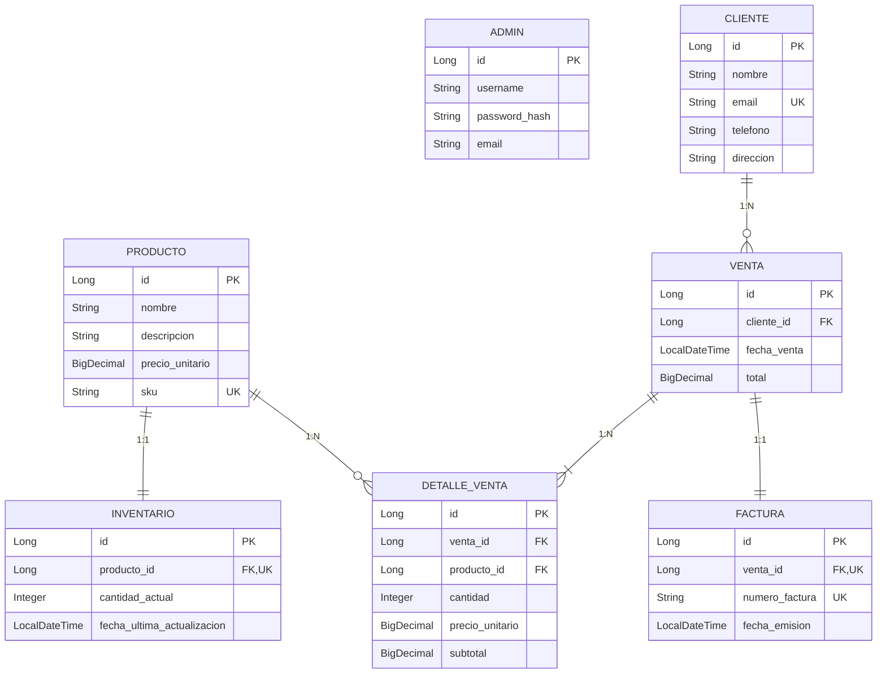

# 📦 Sistema de Gestión de Inventario y Ventas (Full-Stack Monorepo)

Sistema integral de gestión de productos, inventario en tiempo real, registro de clientes, ventas multiactivo y facturación correlativa automática. Diseñado con una arquitectura moderna, escalable y contenedorizada con Docker.

---

## 🛠️ 1. Stack Tecnológico

| Capa | Tecnología | Descripción |
| :--- | :--- | :--- |
| **Frontend** | [Next.js 14](https://nextjs.org/) (App Router) | React Server Components, TypeScript y [TailwindCSS](https://tailwindcss.com/) |
| **Backend** | [Java 17](https://www.oracle.com/java/) / [Spring Boot 3](https://spring.io/projects/spring-boot) | REST API, Spring Data JPA, Hibernate, Bean Validation |
| **Base de Datos** | [MariaDB 11.4](https://mariadb.org/) | Motor relacional transaccional optimizado |
| **DevOps / Infra** | [Docker](https://www.docker.com/) & Docker Compose | Contenedores multi-stage builds con tamaño mínimo |

---

## 🏛️ 2. Arquitectura de Entidades y Base de Datos

El backend mapea 7 entidades JPA que implementan la lógica del negocio:



1. **Admin:** Credenciales y acceso al sistema (`id`, `username`, `password_hash`, `email`).
2. **Producto:** Catálogo maestro (`id`, `nombre`, `descripcion`, `precio_unitario`, `sku`).
3. **Inventario:** Stock en tiempo real y timestamps (`id`, `producto_id`, `cantidad_actual`, `fecha_ultima_actualizacion`).
4. **Cliente:** Información de contacto (`id`, `nombre`, `email`, `telefono`, `direccion`).
5. **Venta:** Cabecera de venta transaccional con total (`id`, `cliente_id`, `fecha_venta`, `total`).
6. **DetalleVenta:** Relación muchos a muchos para incluir múltiples productos en cada venta (`id`, `venta_id`, `producto_id`, `cantidad`, `precio_unitario`, `subtotal`).
7. **Factura:** Factura correlativa emitida automáticamente tras cada venta (`id`, `venta_id`, `numero_factura`, `fecha_emision`).

---

## 🖥️ 3. Módulos y Pantallas del Frontend

El frontend cuenta con un menú de navegación lateral responsivo y 3 vistas funcionales:

*   **Pantalla 1 - Dashboard General (`/`):**
    *   Tarjetas de métricas (KPIs): Total recaudado, cantidad de ventas, catálogo total y alertas de stock bajo.
    *   Tabla de suministros críticos (productos con stock $\le 10$ unidades con botón rápido para reponer).
    *   Feed en vivo de las últimas ventas emitidas.
*   **Pantalla 2 - Gestión de Inventario y Productos (`/productos`):**
    *   Tabla interactiva con SKU, Nombre, Precio, Stock, Estado dinámico (Disponible, Bajo Stock, Agotado).
    *   Búsqueda en tiempo real por SKU o Nombre.
    *   Modal para **Crear y Editar Productos**.
    *   Modal para **Ajuste Rápido de Stock** directo en almacén.
    *   Acción de eliminación con confirmación.
*   **Pantalla 3 - Registro de Ventas y Facturación (`/ventas`):**
    *   Selector de Cliente (con modal integrado para registrar nuevos clientes al instante).
    *   Selector múltiple de productos con cálculo dinámico de subtotales y total general.
    *   Control y validación estricta de stock disponible (impide vender más de lo existente).
    *   Generación automática de Factura fiscal con numeración correlativa (`FAC-AAAAMM-000001`).
    *   Visualizador / Imprimidor de factura con formato corporativo.

---

## 📂 4. Estructura del Monorepo

```
inventario/
├── backend/                        # API REST en Java Spring Boot
│   ├── src/
│   │   └── main/
│   │       ├── java/com/sistema/inventario/
│   │       │   ├── config/         # Configuración CORS, Seeder de datos
│   │       │   ├── controller/     # Controladores REST API
│   │       │   ├── dto/            # Data Transfer Objects
│   │       │   ├── exception/      # Manejo global de excepciones
│   │       │   ├── model/          # Entidades JPA / Hibernate
│   │       │   ├── repository/     # Interfaces Spring Data JPA
│   │       │   ├── service/        # Lógica de negocio transaccional
│   │       │   └── InventarioBackendApplication.java
│   │       └── resources/
│   │           └── application.properties
│   ├── Dockerfile                  # Multi-stage build con Maven y Temurin JRE
│   └── pom.xml                     # Dependencias Maven
├── frontend/                       # Aplicación Web en Next.js
│   ├── public/                     # Archivos estáticos
│   ├── src/
│   │   ├── app/                    # App Router (páginas y layouts)
│   │   │   ├── globals.css         # Estilos globales con TailwindCSS
│   │   │   ├── layout.tsx          # Layout maestro con Sidebar y Navbar
│   │   │   ├── page.tsx            # Pantalla 1: Dashboard
│   │   │   ├── productos/page.tsx  # Pantalla 2: CRUD Productos e Inventario
│   │   │   └── ventas/page.tsx     # Pantalla 3: Ventas y Facturas
│   │   ├── components/             # Componentes modulares UI
│   │   ├── services/api.ts         # Cliente HTTP tipado hacia el backend
│   │   └── types/index.ts          # Interfaces TypeScript de dominio
│   ├── Dockerfile                  # Multi-stage build optimizado para Next.js
│   ├── next.config.js
│   ├── package.json
│   ├── tailwind.config.js
│   └── tsconfig.json
├── .gitignore                      # Reglas de exclusión para Git
├── docker-compose.yml              # Orquestación de MariaDB + Backend + Frontend
└── README.md                       # Documentación del proyecto
```

---

## 🚀 5. Despliegue con Docker (Un solo comando)

### Prerrequisitos
*   [Docker](https://docs.docker.com/get-docker/) y [Docker Compose](https://docs.docker.com/compose/) instalados y en ejecución.

### Ejecución
En la raíz del proyecto, ejecuta:

```bash
docker-compose up -d --build
```

Docker descargará MariaDB, compilará el backend con Maven, construirá el frontend de Next.js y conectará los 3 servicios en una red privada.

### Verificación de Servicios
Una vez levantado:
*   🌐 **Frontend (Web):** [http://localhost:3000](http://localhost:3000)
*   ☕ **Backend (API REST):** [http://localhost:8080/api](http://localhost:8080/api)
*   🐬 **MariaDB:** `localhost:3306` (Base de datos: `inventario_db`, Usuario: `inventario_user`, Password: `inventario_pass`)

> **Nota:** El sistema incluye un inicializador automático (`DataInitializer`) que precarga un usuario administrador, clientes, productos e inventario de prueba para que puedas explorar el sistema de inmediato.

Para detener los contenedores:
```bash
docker-compose down
```

---

## ⚙️ 6. Variables de Entorno

| Variable | Servicio | Valor por Defecto en Docker | Descripción |
| :--- | :--- | :--- | :--- |
| `SPRING_DATASOURCE_URL` | Backend | `jdbc:mariadb://mariadb:3306/inventario_db?...` | Cadena de conexión JDBC |
| `SPRING_DATASOURCE_USERNAME` | Backend | `inventario_user` | Usuario de base de datos |
| `SPRING_DATASOURCE_PASSWORD` | Backend | `inventario_pass` | Clave de base de datos |
| `CORS_ALLOWED_ORIGINS` | Backend | `http://localhost:3000` | Orígenes web autorizados |
| `SERVER_PORT` | Backend | `8080` | Puerto del servidor Java |
| `NEXT_PUBLIC_API_URL` | Frontend | `http://localhost:8080/api` | Endpoint base para el cliente web |
| `MYSQL_ROOT_PASSWORD` | MariaDB | `rootpassword` | Contraseña root de MariaDB |

---

## 🔌 7. Endpoints Principales de la API REST

*   `GET /api/dashboard/resumen` - Métricas clave del dashboard.
*   `GET /api/productos` - Listar todos los productos con su inventario.
*   `POST /api/productos` - Crear producto e inicializar su inventario.
*   `PUT /api/productos/{id}` - Actualizar datos del producto.
*   `DELETE /api/productos/{id}` - Eliminar producto.
*   `GET /api/inventarios` - Listar estado del inventario.
*   `PUT /api/inventarios/producto/{id}/ajustar` - Ajuste manual de existencias.
*   `GET /api/clientes` - Listar clientes.
*   `POST /api/clientes` - Registrar nuevo cliente.
*   `POST /api/ventas` - Registrar venta múltiple, descontar stock y generar factura correlativa.
*   `GET /api/ventas` - Listar historial de ventas y facturas.

---

## 🐙 8. Comandos Git para Subir el Proyecto a GitHub

Abre tu terminal en la raíz de esta carpeta y sigue estos pasos:

```bash
# 1. Inicializar el repositorio Git
git init

# 2. Agregar todos los archivos respetando el .gitignore
git add .

# 3. Crear el commit inicial
git commit -m "feat: Sistema de Gestión de Inventario y Ventas (Full-Stack Next.js, Spring Boot, MariaDB, Docker)"

# 4. Cambiar a la rama principal 'main'
git branch -M main

# 5. Vincular con tu repositorio remoto de GitHub (reemplaza con tu URL)
git remote add origin https://github.com/TU_USUARIO/TU_REPOSITORIO.git

# 6. Subir los cambios a GitHub
git push -u origin main
```
